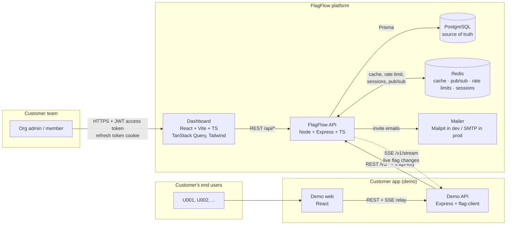
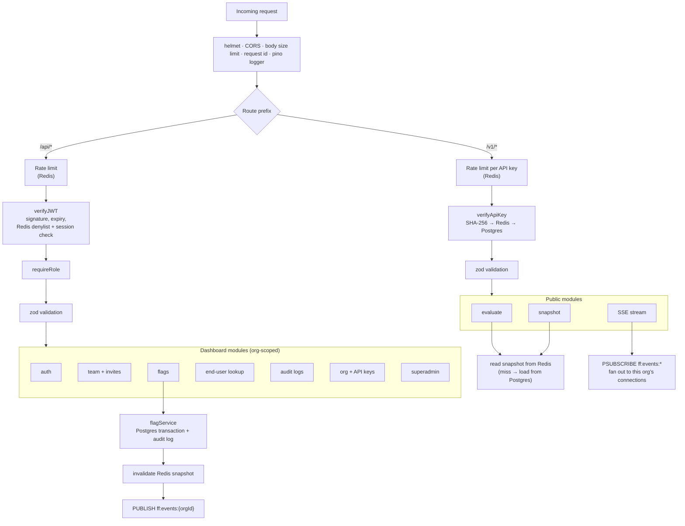
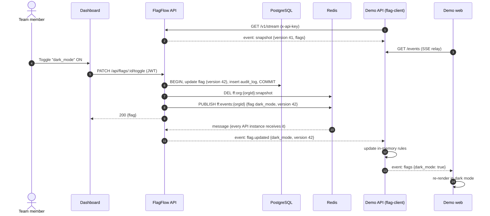
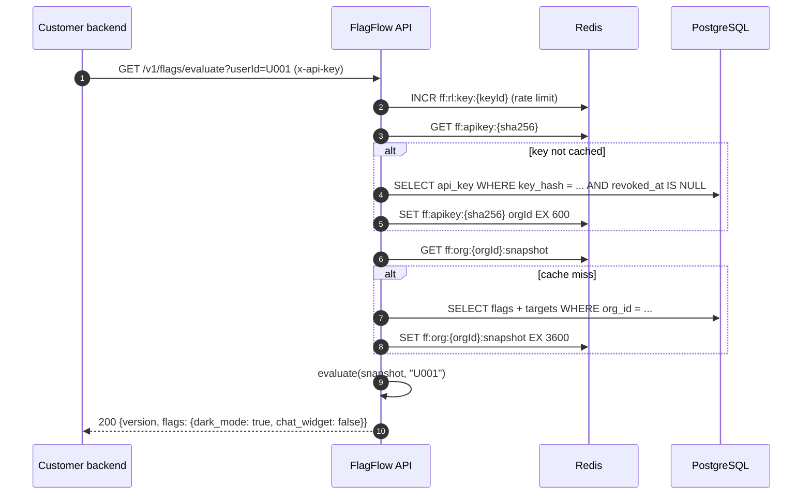
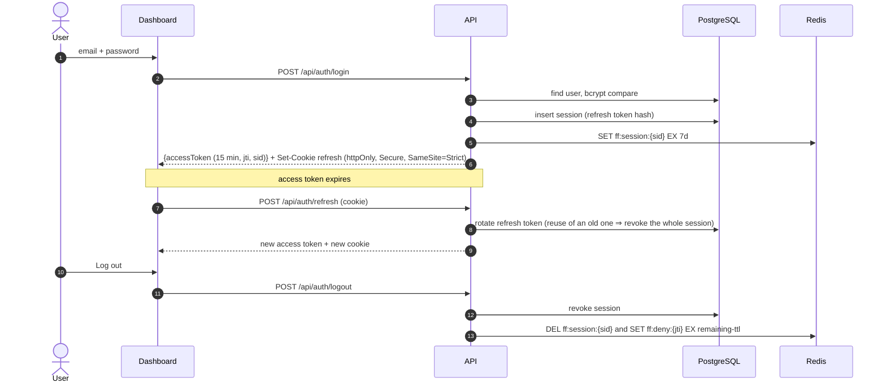
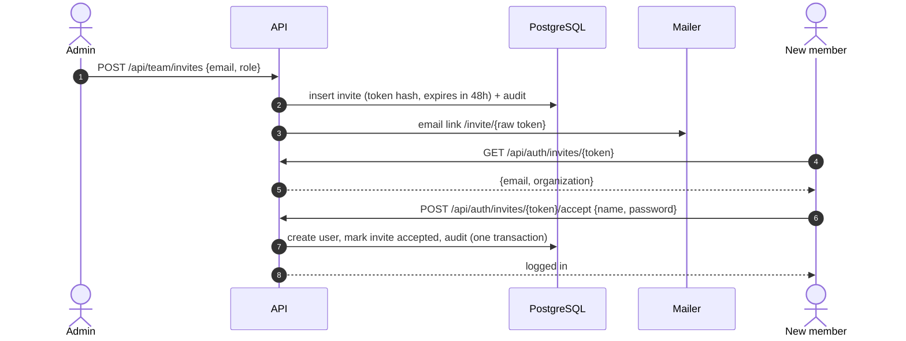
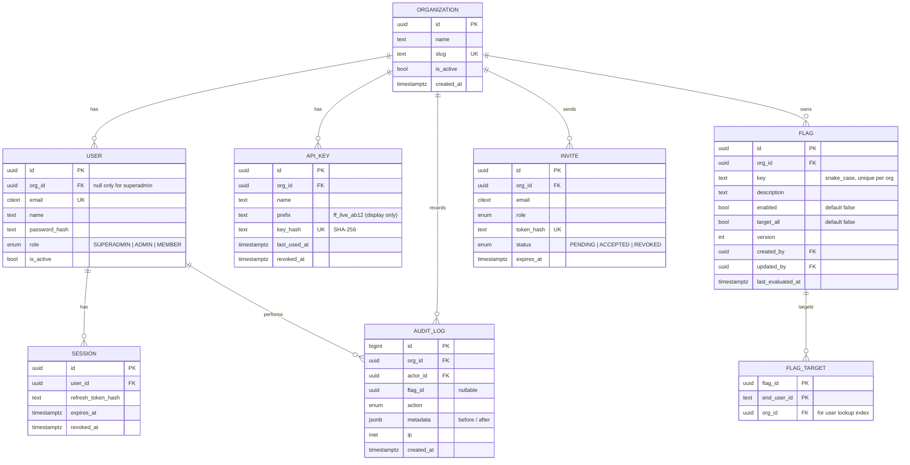
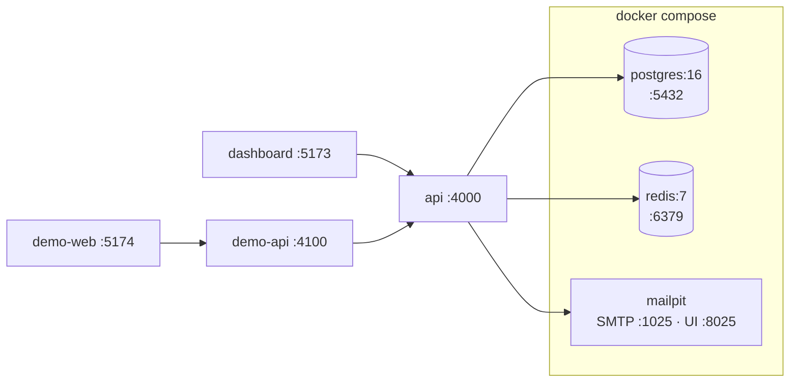
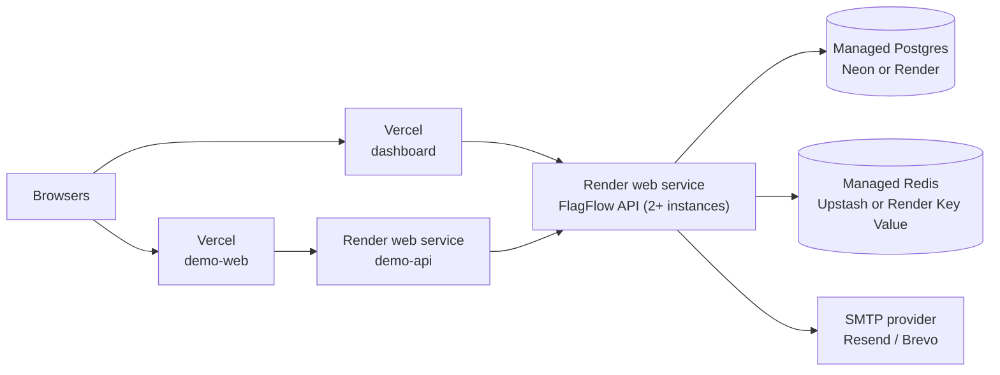

# FlagFlow — Architecture

**Goal:** let teams enable or disable features for specific users of their app **without redeploying it**.

**Stack:** React + TypeScript (Vite) · Node.js + Express + TypeScript · PostgreSQL (Prisma) · Redis

---

## 1. System overview



Two kinds of callers, two kinds of credentials:

| Caller | Credential | Routes |
|---|---|---|
| Dashboard users (admins, members, superadmin) | JWT access token (15 min) + rotating refresh token in an httpOnly cookie | `/api/*` |
| Customer backends (the demo API) | Org API key in `x-api-key` header — server-to-server only | `/v1/*` |

End users (`U001`…) never log into FlagFlow. FlagFlow only knows them as ID strings sent by the customer's backend.

## 2. Inside the FlagFlow API



Rules every module follows:
- The org ID always comes from the verified JWT or API key, **never** from the request body or URL.
- Every change runs inside a Postgres transaction that also writes an `AuditLog` row.
- After the transaction commits: delete the org's Redis snapshot, then publish an event.
- Flag evaluation uses a single shared function, `evaluate()` from `packages/shared`, so the API, the flag-client and the tests can never disagree.

## 3. Key flows

### 3.1 Team toggles a flag → demo app updates live (no redeploy)



If the stream drops, the flag-client reconnects with `Last-Event-ID: 42`. If it has missed events, the API sends a fresh snapshot.

### 3.2 Public flag check (cache-aside)



Unknown flag, unknown user, or any error on the customer's side ⇒ `false` (safe default).

### 3.3 Dashboard authentication



### 3.4 Invite a member



## 4. Data model (PostgreSQL via Prisma)



Indexes: `flag (org_id, key) UNIQUE`, `flag_target (org_id, end_user_id)`, `audit_log (org_id, created_at DESC)`, `api_key (key_hash) UNIQUE`, `invite (token_hash) UNIQUE`.

**Kanban column (worked out, not stored):** `enabled = false` → *Inactive*; enabled for specific users → *Testing*; enabled with `target_all` → *Live*.

**Evaluation rule:** `enabled && (target_all || targets.has(userId))`.

## 5. Redis usage

| Purpose | Key / channel | Type | TTL | Written when |
|---|---|---|---|---|
| Flag snapshot cache | `ff:org:{orgId}:snapshot` | string (JSON: version + flags + targets) | 1 h | Cache miss; deleted on every flag change |
| API key → org | `ff:apikey:{sha256}` | string | 10 min | First use; deleted when the key is revoked |
| Live updates | `ff:events:{orgId}` | pub/sub channel | — | After every committed flag change |
| Rate limits | `ff:rl:{scope}:{id}` | counter (`rate-limit-redis`) | window | Every limited request |
| Active sessions | `ff:session:{sid}` | string (userId) | 7 days | Login / refresh; deleted on logout or revoke |
| Revoked access tokens | `ff:deny:{jti}` | string | rest of the token's 15 min | Logout, password change, member removal |

Redis is never the source of truth: if it is flushed, everything rebuilds from Postgres. The only thing lost is the denylist, which is why access tokens live just 15 minutes.

Rate limits: login 5 per minute per IP+email; `/api/*` 300 per minute per user; `/v1/*` 600 per minute per API key; open SSE streams capped at 20 per key.

## 6. Repository layout (npm workspaces monorepo)

```
FlagFlow/
├── apps/
│   ├── api/            # FlagFlow API — Express + Prisma + ioredis
│   ├── dashboard/      # FlagFlow dashboard — React + Vite
│   ├── demo-api/       # Demo customer backend — uses packages/flag-client
│   └── demo-web/       # Demo customer frontend — 6 flag-controlled features
├── packages/
│   ├── shared/         # zod schemas, shared types, evaluate()
│   └── flag-client/    # Node client: snapshot + SSE + local evaluation
├── e2e/                # Playwright tests across dashboard + demo
├── security/           # attack test suite, ZAP config, scan scripts
├── docs/               # this file, API reference (generated OpenAPI)
├── docker-compose.yml  # postgres, redis, mailpit
└── package.json        # workspaces + root scripts (dev, test, verify, security)
```

## 7. Local development



`npm run dev` starts all four apps. `docker compose up -d` starts Postgres, Redis and Mailpit.

## 8. Production deployment



Running several API instances is safe because the cache, rate limits, sessions and SSE fan-out all go through Redis, not process memory.

## 9. Security design

| Threat | Control |
|---|---|
| One org reading or changing another org's data (IDOR) | Org ID taken only from the token or key; every Prisma query filters on `orgId`; cross-tenant tests on every route |
| Privilege escalation | `requireRole` on every admin route; `role` and `orgId` never accepted from request bodies (zod strips unknown fields) |
| Stolen or forged JWT | HS256 with a 256-bit secret, `alg` pinned, 15 min lifetime, `jti` denylist, session check in Redis |
| Refresh token theft | httpOnly + Secure + SameSite=Strict cookie, rotation with reuse detection, stored hashed |
| CSRF | Refresh endpoint needs the SameSite cookie plus an `X-Requested-With` header; every other route uses a bearer token |
| API key leaks | Stored as SHA-256 only; shown once; can be revoked and rotated; server-to-server only (no browser CORS on `/v1`) |
| Brute force | Redis rate limits on login, invite accept and `/v1`; bcrypt cost 12 |
| Injection | Prisma parameterised queries; zod validation; flag keys must match `^[a-z0-9_]{2,64}$` |
| Stored XSS | React escaping; no `dangerouslySetInnerHTML`; strict Content-Security-Policy on the dashboard |
| Leaking data across tenants over SSE | Stream subscriptions keyed by the org from the API key; tests assert org B never receives org A's events |
| Secrets in git | `.env` gitignored; gitleaks scan before every push |
| Vulnerable dependencies | `npm audit --audit-level=high` in the verify gate |
